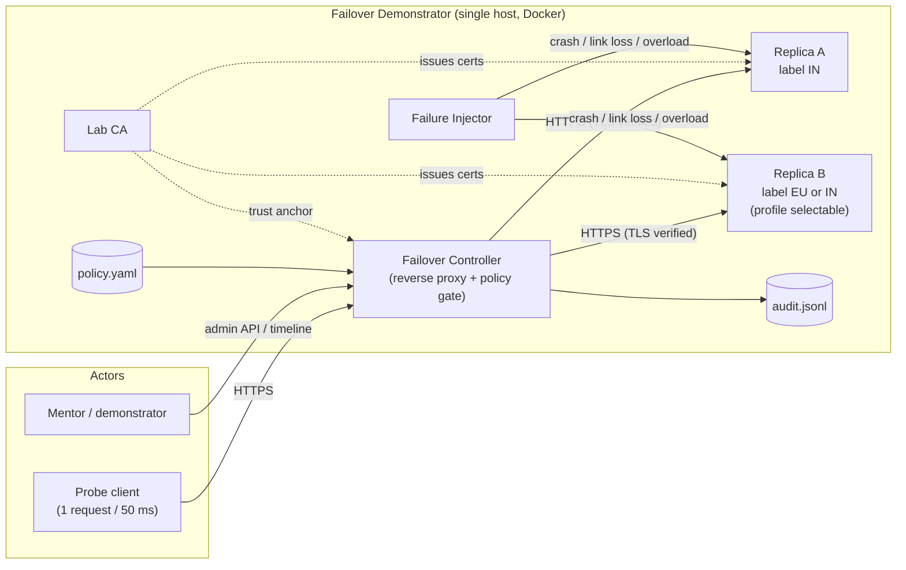
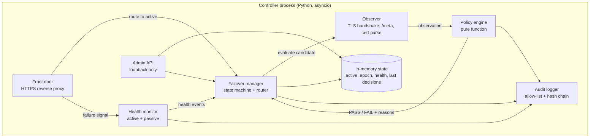
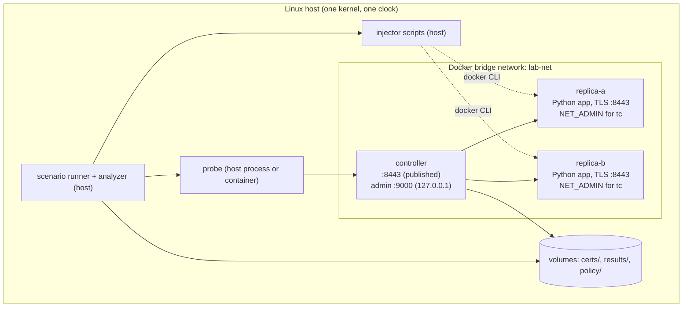
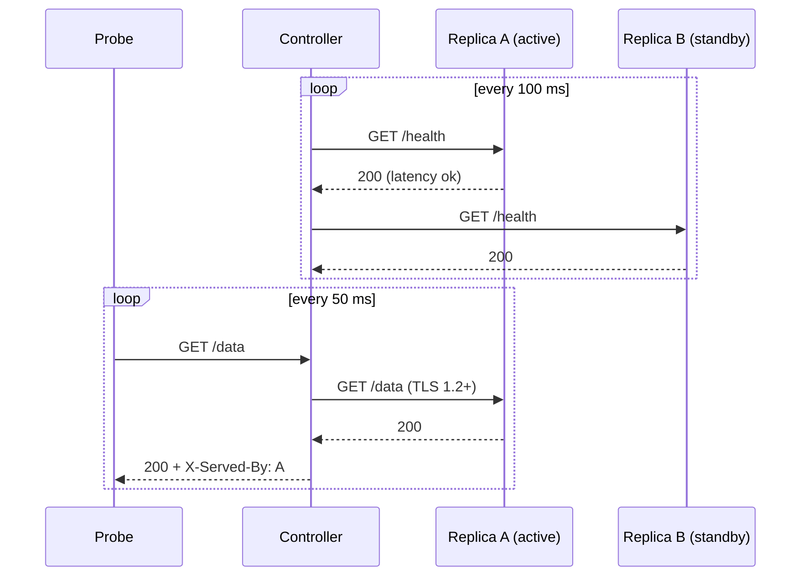
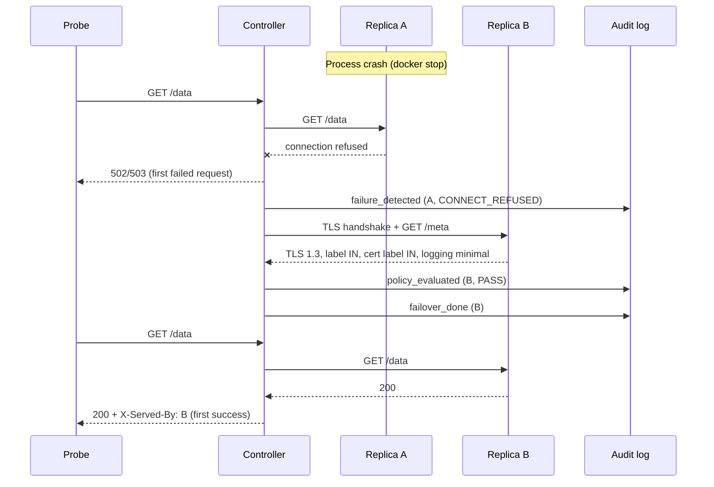
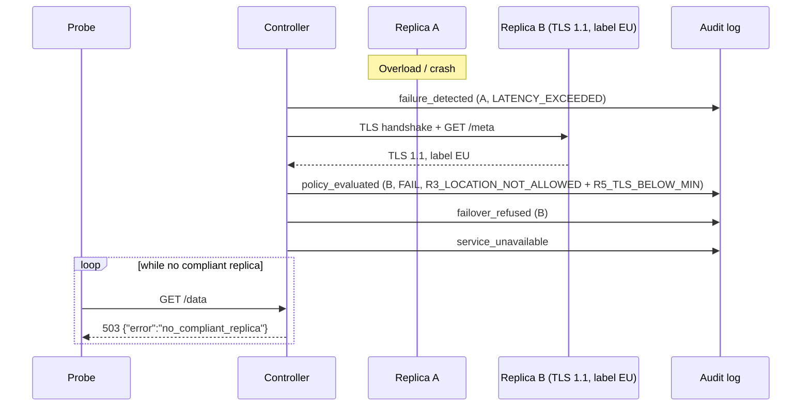
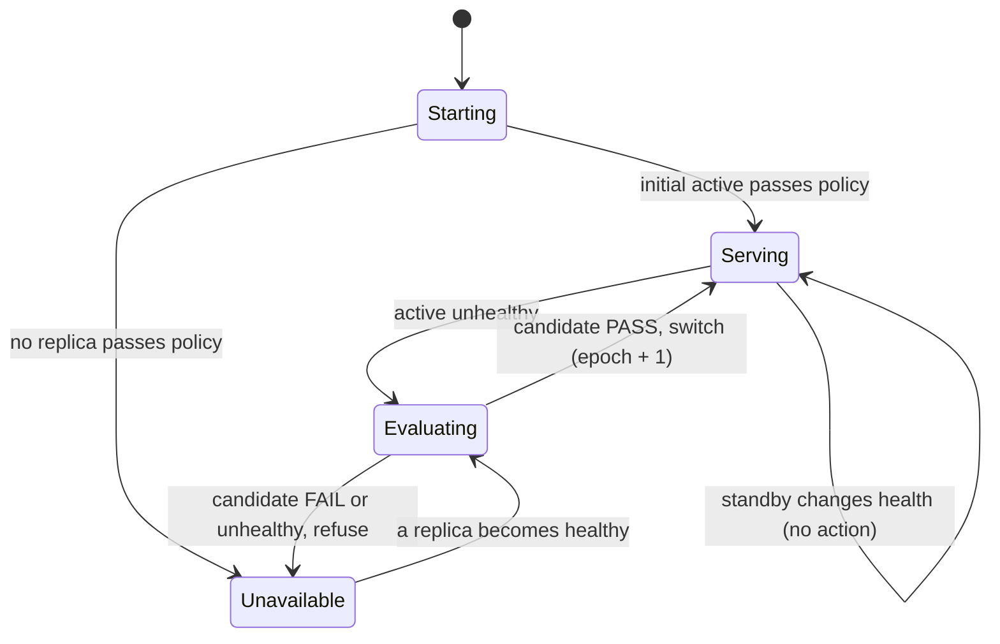
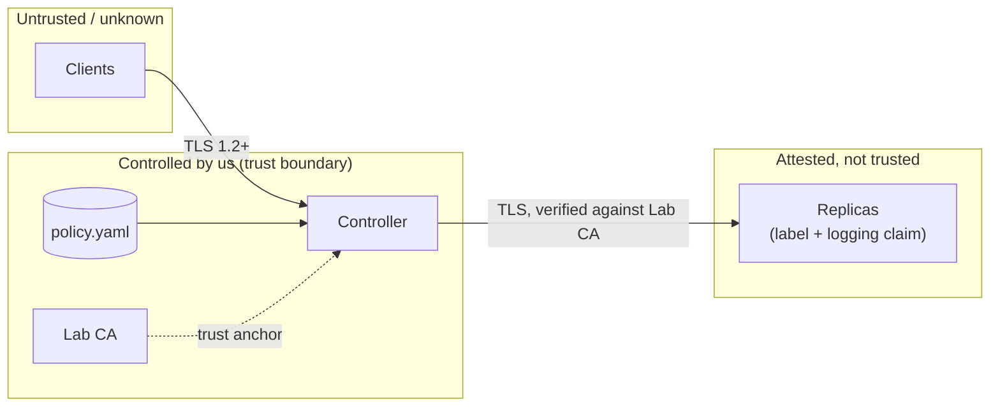

# Architecture

**Project:** PS-006 Policy-Constrained Service Failover Demonstrator
**Team:** Algo-Ancesstors (`A3-PS006-TC329`), AIORI Hackathon 3
**Authors:** Ankur Pratap Singh, Dev Saraswat
**Version:** 0.1 (draft)   **Date:** 2026-10-19

Related documents: [PRD](PRD.md) · [System Design](System%20Design.md) · [MVP Tech Doc](MVP%20Tech%20Doc.md)

---

## 1. Purpose and reading guide

This document describes **what the system is made of and why**: components, how they connect, how they behave at runtime, where trust boundaries sit, and which design decisions we made. The [System Design](System%20Design.md) document goes one level deeper (modules, algorithms, schemas, commands). The [PRD](PRD.md) holds the requirements this architecture satisfies.

Requirement IDs such as `FR-14` and `NFR-02` refer to the PRD.

## 2. Architectural drivers

| Driver | Consequence for the architecture |
|---|---|
| Switch must be **fully under our control** | Clients talk only to a controller acting as a reverse proxy (not DNS or a floating IP) |
| Policy decisions must be **deterministic and explainable** | Policy engine is a pure function; observation (I/O) is separated from decision (logic) |
| Never send traffic to a non-compliant replica (NFR-02) | A policy gate sits on every route change; the system **fails closed** |
| Evidence is a deliverable | Every step writes a typed, timestamped, hash-chained audit event |
| Downtime must be measured honestly | Measurement is done by an **external probe**, not by the controller itself |
| Small team, short timeline | One host, Docker Compose, one language (Python) for our code, standard tools (OpenSSL, `tc`, Docker) for the rest |
| Lab scope only | No HA controller, no real geolocation, no legal logic |

## 3. System context

External actors are only the probe (standing in for real clients) and the people running the demo. Nothing outside the host is contacted.

## 4. Component view

### 4.1 Component responsibilities

| Component | Responsibility | Owns | Does **not** do |
|---|---|---|---|
| **Front door** | Terminate client TLS, forward requests to the active replica, add `X-Served-By` and `X-Failover-Epoch`, return 503 in fail-closed state | Client-facing listener, upstream connection pools | Decide anything about policy |
| **Health monitor** | Check both replicas periodically; apply consecutive-failure thresholds; accept passive failure signals from the front door; emit `HEALTHY`/`UNHEALTHY` transitions with a reason code | Per-replica health counters | Switch traffic |
| **Observer** | Gather facts about a candidate: TLS handshake result (negotiated version, certificate), `/meta` content, certificate SAN label | All network I/O needed for a policy decision | Interpret the facts |
| **Policy engine** | Compare an observation with the loaded policy and return PASS/FAIL with ordered reason codes | Policy object (immutable once loaded) | Any I/O or clock access |
| **Failover manager** | Run the state machine; call observer and policy engine; update the active replica and epoch; enforce the policy gate on every route change | `active`, `epoch`, controller state | Raw network checks |
| **Audit logger** | Write allow-listed events as hash-chained JSON Lines | Audit file, chain head | Business decisions |
| **Admin API** | Read state, read timeline, reload policy, request a manual switch (gated by policy) | Loopback HTTP listener | Bypass the policy gate |
| **Replica** | Serve `/health`, `/data`, `/meta` over HTTPS with its own certificate and TLS settings | Its label, profile and logging claim | Know about the controller |
| **Lab CA** | Issue replica and controller certificates containing a location SAN | Root key (local, never committed) | Run at runtime |
| **Failure injector** | Apply and remove crash, link loss and overload on a chosen replica; log its own timestamps | Fault lifecycle (`inject`, `verify`, `cleanup`) | Touch the controller |
| **Probe** | Send requests at a fixed 50 ms schedule and record results | Probe log | Know about replicas |
| **Analyzer / runner** | Orchestrate scenarios, compute downtime, merge timelines, produce result files | `results/` | Run in the data path |

### 4.2 Interfaces between components

| From → To | Protocol | Content | Notes |
|---|---|---|---|
| Probe → Front door | HTTPS (TLS 1.2+) | `GET /data` | Verifies controller cert against the lab CA |
| Front door → Replica | HTTPS | Proxied request | Data-path TLS context has `minimum_version = TLS 1.2`, a second line of defence if a weak replica were ever selected |
| Health monitor → Replica | HTTPS | `GET /health` | Latency measured per check |
| Observer → Replica | HTTPS | Handshake plus `GET /meta` | Observer context allows legacy versions so that it can *see* a weak replica instead of failing blindly |
| Admin client → Admin API | HTTP on loopback | JSON | Not exposed outside the host |
| Injector → Docker | Docker CLI / socket | `stop`, `kill`, `exec tc ...`, `network disconnect` | Runs on the host |
| Components → Audit | Function call | Event dict | Filtered by allow-list |

## 5. Deployment view

All pieces run on one Linux host (or VM) under Docker Compose. One clock serves every component, so timestamps are comparable without synchronization.

| Item | Choice | Reason |
|---|---|---|
| Orchestration | Docker Compose v2 | One command to start, stop and reset |
| Network | One user-defined bridge, `lab-net` | Service-name DNS, easy to cut with `network disconnect` |
| Replica TLS | Python `ssl` context built from the replica's profile, served by `aiohttp` | Exact control of minimum and maximum TLS version, confirmed in a spike; no extra process in the container |
| Replica app | `aiohttp`, one process per container | Small; accepts a full `SSLContext` (uvicorn does not) |
| Ports | Controller 8443 published; admin 9000 on `127.0.0.1`; replica ports also published on loopback (9443, 9444) for direct load generation | Keep the data path through the controller; allow direct load for the overload scenario |
| Volumes | `certs/` (generated locally), `policy/`, `results/` | Keys never enter the image or the repository |

## 6. Runtime views

### 6.1 Steady state

### 6.2 Failover accepted (crash of A, B compliant)

### 6.3 Failover refused (candidate violates policy)

No request ever reaches B. This is the safety invariant of NFR-02.

## 7. Controller state machine

| State | Meaning | Client behaviour |
|---|---|---|
| Starting | Loading config and policy, first observations | 503 |
| Serving | An active replica is healthy and compliant | Proxied to active |
| Evaluating | Active failed; candidate under review (milliseconds) | Requests fail or are held (`hold_and_retry`) |
| Unavailable | No compliant healthy replica; fail closed | 503 with `no_compliant_replica` |

Transitions are serialized by a single asyncio lock, so there is exactly one active replica at any moment (no split brain inside the controller). Each switch increments an **epoch** number that is exposed as `X-Failover-Epoch` and appears in the timeline.

## 8. Data architecture

| Data | Format | Producer | Consumer | Retention |
|---|---|---|---|---|
| Policy | YAML | Team | Policy engine | Versioned in Git; SHA-256 logged at load |
| Controller config | YAML | Team | Controller | Versioned in Git |
| Audit log | JSON Lines, hash chained | Controller | Timeline viewer, analyzer, mentor | One file per run in `results/` |
| Injector log | JSON Lines (same schema) | Injector | Timeline viewer, analyzer | Per run |
| Probe log | JSON Lines | Probe | Analyzer | Per run |
| Run summary | JSON | Analyzer | Report | Per run |
| Aggregates | CSV and Markdown | Analyzer | Report, PDF | Per matrix run |
| Certificates | PEM | Lab CA script | Replicas, controller, probe | Local only; keys not committed |

Schemas are defined in the [System Design](System%20Design.md) document.

## 9. Security and trust architecture

| Concern | Control |
|---|---|
| Traffic to a wrong-location replica | R3 (label allowed) and R4 (label equals certificate label) |
| Label spoofing through a header or `/meta` alone | Label must also appear in the certificate issued by our CA (R4) |
| TLS downgrade | R5 on the observed handshake, plus a TLS 1.2 minimum on the data-path context; optional strict mode that proves old versions are rejected |
| Untrusted or expired certificate | R2; any TLS verification error fails closed |
| Fake or unreachable candidate | R1; unknown means FAIL |
| Policy file tampering | SHA-256 of the policy is written to the audit log; changes need an explicit reload event |
| Audit tampering | Hash chain; a broken chain is detected by the verifier |
| Over-collection of data | Field allow-list on the audit logger (RFC 6973 data minimization); no client identifiers are stored |
| Admin abuse | Admin API bound to loopback; manual switch still passes the policy gate |
| Key leakage | Private keys are generated locally, kept out of images and out of Git (`.gitignore`) |

**Residual risks (stated openly).** A label is an attested value, not proof of physical location. The logging rule for replicas is a self-declared claim. A TLS check describes one moment, not the future. These are consistent with the limits stated in the brief.

## 10. Key architectural decisions

| ADR | Decision | Alternatives considered | Rationale |
|---|---|---|---|
| ADR-01 | Controller as a **reverse proxy front door** | DNS failover, virtual IP, service mesh | The switch is instantaneous and fully under our control; matches the approach document |
| ADR-02 | **Separate observation from decision**: observer does I/O, policy engine is pure | One function that probes and decides | Determinism (NFR-01), easy table-driven tests, decisions can be replayed from recorded observations |
| ADR-03 | **Fail closed** | Fail open to keep availability | The purpose of the project is that policy outranks availability |
| ADR-04 | **Python `ssl` context built from a profile** in each replica, served by `aiohttp` | nginx as TLS terminator; FastAPI with uvicorn | uvicorn cannot cap the TLS version, aiohttp takes a full `SSLContext`; a spike confirmed that a TLS 1.1-only server and a strict client behave as designed. nginx remains a fallback |
| ADR-05 | Location label in **certificate SAN URI** and in `/meta`; both must agree | Header only, config only | Binding the label to a CA-issued certificate raises the cost of spoofing at almost no extra effort |
| ADR-06 | **Python asyncio** for the controller | Go, Node.js, HAProxy plus scripts | Team skill, quick iteration, standard `ssl` module gives negotiated version and peer certificate |
| ADR-07 | **JSONL audit log with allow-list and hash chain** | Plain text logs, database | Simple, human-readable, privacy-minimal, tamper-evident |
| ADR-08 | **Sticky active**, no automatic failback | Always prefer A | Prevents flapping and extra downtime |
| ADR-09 | **External probe** measures downtime | Controller measures internally | The client's view is the truth; avoids grading our own work |
| ADR-10 | **Active plus passive** health detection | Active only | Passive signals shorten detection of crashes at no extra load |
| ADR-11 | **Docker Compose on one host** | Real multi-VM or cloud | Fast to reproduce, one clock, within the brief's lab scope |
| ADR-12 | Data-path TLS context stricter than the observer context | One shared context | Defence in depth; observer must see weak servers, the data path must refuse them |

## 11. Quality attributes and tactics

| Attribute | Tactic |
|---|---|
| Correctness | Pure policy function, exhaustive rule tests, safety invariant checked in every run |
| Availability (within policy) | Short health interval, two-failure threshold, passive detection, optional hold-and-retry |
| Determinism | No randomness or hidden state in decisions; fixed rule order; reason codes sorted by rule number |
| Performance | One asyncio loop, persistent upstream connections, no logging of payloads |
| Auditability | Every transition emits an event; events replay the story without reading code |
| Privacy | Allow-listed fields only |
| Testability | Observation can be constructed by hand; clock is injected; injectors have verify and cleanup |
| Reproducibility | `make demo`, pinned dependencies, results stored per run |

## 12. Failure-mode analysis

| Failure | Detection | System response | Evidence |
|---|---|---|---|
| Active replica process crash | Connection refused or non-200 | Evaluate candidate, switch or refuse | `failure_detected`, `policy_evaluated`, `failover_done` or `failover_refused` |
| Link loss to active | Connect or read timeout | Same | Same, reason `CONNECT_TIMEOUT` |
| Overload of active | Latency above threshold or timeouts | Same | Reason `LATENCY_EXCEEDED` |
| Both replicas down | Both unhealthy | Fail closed | `service_unavailable` |
| Candidate violates policy | Policy FAIL | Refuse, alert, 503 | `failover_refused` with reason codes |
| Candidate unreachable during evaluation | R1 fails | Refuse | `R1_UNREACHABLE` |
| Invalid policy file at start | Validation error | Controller does not start | Console error |
| Invalid policy on reload | Validation error | Keep previous policy | `policy_load_failed` event |
| CA file missing | R2 fails for every replica | Fail closed | `R2_CERT_UNTRUSTED` |
| Audit file not writable | Write error | Stop switching, fail closed (no decision without evidence) | Console error |
| Controller crash | External | Restart; chain continues from the last line; initial active re-evaluated | `controller_started` |
| Clock jump | N/A | Durations use a monotonic clock; wall clock is only for display | n/a |

## 13. Extensibility

The design leaves clean seams for the following (all outside the MVP):

- More than two replicas: the failover manager picks candidates from an ordered list; the policy engine is already per-candidate.
- More rules: add `R7`, `R8` as functions in the same ordered registry.
- A signed attestation endpoint replacing the plain `/meta` claim.
- Controller high availability through leader election and a shared state store.
- Dashboard and metrics export (Prometheus format).
- A policy language richer than YAML (for example, expressions), while keeping determinism.

## 14. Constraints and limits

- Lab demonstrator only. No production deployment.
- No legal compliance logic and no Internet-path residency guarantee.
- Single host, single controller.
- Measurement resolution equals the probe interval (50 ms).
- Weak TLS demonstration depends on the OpenSSL build; see PRD risk R-01 and the fallbacks listed there.
